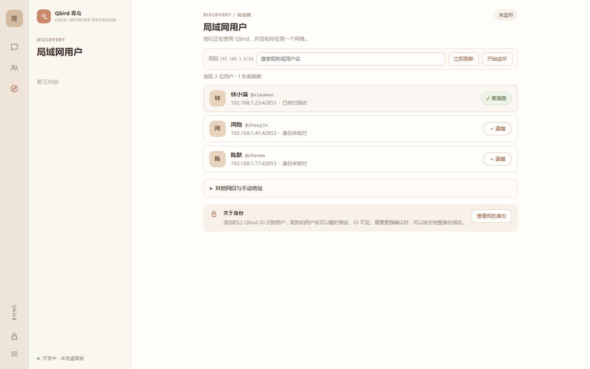

# Qbird

**A lightweight, security-minded, local-first LAN messenger—easy to run and designed to grow through plugins.**

English · [简体中文](README_CN.md)

Qbird (Chinese name: **青鸟**) aims to make private, direct messaging on a local network simple to deploy—without a hosted relay or account service. The core is intended to stay small and focused on the essentials: identity, discovery, messaging and local data. Capabilities beyond that foundation should be added as plugins, so users can choose what to install instead of carrying every feature in the core. Windows is the first development target; Linux and macOS remain planned.

> **Development preview · 0.1.12-beta** — This is a pre-release beta, not a production release. Real two-device, multi-device and current desktop UI acceptance are still incomplete. The local database is not encrypted, and the project has not received an independent security audit. **Do not use it for real communication or sensitive information.** “Private by default” is the design goal, not a claim that this beta is security-audited.

## Interface preview



*Current 0.1.12-beta discovery UI shown with built-in demo data. The displayed contacts, names and private-network addresses are fictional; this image does not show a live network or real chat data.*

## Features

The following are implemented to varying degrees in the development build. Automated tests and real-world acceptance are different; see [the task list](docs/TASKS.md) for details.

| Area | Development preview |
| --- | --- |
| **Getting started and discovery** | First-run onboarding; same-subnet mDNS discovery, manual addresses, rate-limited subnet scanning and a blocklist. Contact addition probes the peer's fingerprint; automatic acceptance can be disabled. |
| **Conversations** | Local self-chat, direct and group chats, hidden conversations, unread counts, search, replies and group mentions. Text and up to nine images can share a message bubble. |
| **Contacts and groups** | Contact profiles, notes and groups; group invitations, member management and join times, group search, join requests and avatars. Invitations require confirmation by default; automatic joining is optional. |
| **Files and images** | Direct and group file transfers with queues, resume and SHA-256 checks; configurable receive directories and confirmation policies; image viewing and a preview workspace. Completed attachments can be opened with the system default app. |
| **Workspace and extensions** | A global tabbed side workspace previews images (zoom and rotate), PDFs (via the WebView2 built-in reader), TXT/Markdown/HTML and web links; tabs can be reordered, split into two groups and restored after restart; emoji, local sticker favorites, input preferences, app lock and storage quota. An experimental, local **read-only preview plugin host** is available; Office viewer plugins are not bundled. |
| **Export and backup** | Plain-text and password-protected chat export/import; password-protected database backup with merge or overwrite restore. Identity keys and attachments are not included in database backups. |
| **Diagnostics** | A "debug mode" settings tab with read-only local network checks (listener, port, discovery, IPv4), bounded repairs (restart the chat listener, rebuild mDNS discovery) and storage checks (attachment quota, database size, free space of receive folders). |

Qbird is built with **Tauri, Rust, TypeScript, Vite and SQLite**. Records are stored locally and peer-to-peer communication does not use an intermediary server.

## Project vision: a small core, plugin-first extensions

The long-term direction is to keep Qbird's foundation light and dependable, then add optional capabilities as plugins rather than expanding the core for every use case. Examples on the roadmap include richer sidebar file-preview providers and AI Bot integrations. These are **ideas, not shipped features**. Today the app includes an experimental, local, read-only preview-plugin host; it is not yet a stable general-purpose plugin API or marketplace. See [the plugin notes](docs/PLUGIN.md) for its current limits.

## Source deployment (Windows x64)

Windows x64 is currently the only supported platform for building from source. The steps below assume Windows 10/11 with the Visual Studio build tools and Rust installed.

### 1. Toolchain requirements

| Component | Requirement | Purpose / notes |
| --- | --- | --- |
| Windows | 10 or 11 x64 | Only supported platform |
| Microsoft C++ Build Tools | Visual Studio 2022 Build Tools with "Desktop development with C++" and a Windows 10/11 SDK | Compiles Rust and links the MSVC runtime |
| Rust | `stable-x86_64-pc-windows-msvc` installed via [rustup](https://rustup.rs/), with `cargo` on `PATH` | Backend and desktop shell |
| Node.js | 22 LTS or newer (CI uses Node 22) | Frontend build |
| pnpm | 11.22.0 (pinned by `packageManager` in `package.json`) | Install with `corepack enable` or `npm i -g pnpm@11.22.0` |
| WebView2 Runtime | Evergreen | Usually preinstalled on Windows 11; the installer bootstraps it when missing |

Verify the toolchain in a terminal:

```bash
node -v && pnpm -v && cargo -V && rustc -V
```

### 2. Clone and install dependencies

```bash
git clone https://github.com/TamKingsley/Qbird.git
cd Qbird
pnpm install --frozen-lockfile
```

Versions are pinned by `pnpm-lock.yaml` and `src-tauri/Cargo.lock`. If pnpm reports that `node_modules` is out of sync with the lockfile, re-run `pnpm install --frozen-lockfile`; do not edit the lockfiles by hand.

### 3. Run in development

```bash
pnpm tauri dev
```

The first run compiles all Rust dependencies and takes a while; later runs are incremental. The Vite dev server is pinned to `127.0.0.1:1420` (`strictPort`), so it fails instead of switching ports when the port is taken.

To preview only the UI (no desktop shell, no messaging or local database access):

```bash
pnpm dev            # then open http://127.0.0.1:1420/?demo=1
```

`?demo=1` renders the discovery screen with built-in demo data for visual checks only; desktop runs ignore it.

### 4. Checks and tests

```bash
pnpm typecheck     # tsc type check
pnpm build         # version check + type check + production frontend build
cargo check --manifest-path src-tauri/Cargo.toml
cargo test --manifest-path src-tauri/Cargo.toml
```

`pnpm build` first runs `scripts/check-version.mjs`: the versions in `package.json`, `src-tauri/tauri.conf.json`, `src-tauri/Cargo.toml` and `src-tauri/Cargo.lock` must match exactly (pre-release suffixes such as `-beta` are allowed) or the build fails. Bump all four before a release.

Rust tests that depend on Windows DPAPI, real loopback networking or an interactive desktop session fail in headless or sandboxed sessions with "The system cannot find the file specified" or connection errors. Run the full `cargo test` in a normal, logged-in desktop session and trust that result.

### 5. Build distributable artifacts

Build the frontend first, then the release executable:

```bash
pnpm build
cargo build --release --features custom-protocol
```

Output: `src-tauri/target/release/qbird.exe`, a single executable with the frontend embedded, runnable as-is.

Build the NSIS installer (per-user install, with uninstall hooks):

```bash
pnpm tauri build            # or: pnpm tauri bundle --bundles nsis
```

The installer lands in `src-tauri/target/release/bundle/nsis/`. NSIS tooling is required; if `tauri bundle` reports it missing, ship the `qbird.exe` above instead. If `pnpm tauri build` aborts while resolving the Rust project, skip it: run `pnpm build` and `cargo build --release --features custom-protocol` to get the executable, then run `pnpm tauri bundle --bundles nsis` separately.

Build outputs, installers, `dist/` and `src-tauri/target/` are never committed.

### 6. Data directory and portable mode

- The installer writes a `qbird.portable` marker next to the program, so identity, database, attachments, plugins and stickers live in `data\` inside the install directory; on uninstall you are offered a backup to `文档\Qbird 数据` or a full removal.
- When running `qbird.exe` or `pnpm tauri dev` without that marker, data is stored in the system app data directory (`im.qbird.desktop`).
- Quit the app before backing up, migrating or debugging. Never commit `data\`, identity keys, `*.db` files or backups (`.gitignore` covers the common extensions).

### 7. Troubleshooting

- **`cl.exe` fails with `C1083: cannot open include file: 'stddef.h'` or cannot find `windows.h`**: `vcvars64.bat` did not inject the Windows SDK include/lib paths. Add `%WindowsSdkDir%\Include\<version>\ucrt;...\um;...\shared` to `INCLUDE` and `%WindowsSdkDir%\Lib\<version>\ucrt\x64;...\um\x64` to `LIB`, or reinstall the Windows 10/11 SDK component and reopen the terminal.
- **`cargo` fails with `STATUS_DLL_NOT_FOUND` or a broken `rustc`**: usually the rustup proxy binary being blocked. Use the toolchain's real `rustc` (`%USERPROFILE%\.rustup\toolchains\stable-x86_64-pc-windows-msvc\bin`) and re-run `rustup toolchain install stable-x86_64-pc-windows-msvc` if needed.
- **`link.exe` not found**: the terminal has no MSVC environment. Use "x64 Native Tools Command Prompt for VS 2022" or call `vcvars64.bat` first.
- **Port 1420 already in use**: `pnpm dev` uses `strictPort`; free the port instead of changing it, which would desync from `devUrl` in `tauri.conf.json`.
- **Blank window or window creation failure**: make sure WebView2 Runtime is installed and the session has an interactive desktop; headless sessions can fail with `0x800700AA`.
- **Version check failure**: align the four version fields as described in step 4 and re-run `pnpm build`.

See [the product requirements](docs/PRD.md) for data format, distribution and roadmap details.

## Known limitations

- **Verification:** Real two-device, group concurrency, network-failure and current desktop UI acceptance remain incomplete. Successful local or automated tests do not establish production readiness.
- **Offline delivery:** There is no relay. Queued messages and files can be delivered or resumed only when the relevant peers are online.
- **Local data:** SQLite is not encrypted. The optional app lock hides the interface but does not encrypt stored data; Windows authentication reset is not implemented.
- **Backups:** Database backups do not include the identity private key or attachment files. Backup passwords are separate from the app-lock password.
- **Extensions and platforms:** The plugin host is experimental and read-only; editing, a plugin marketplace and bundled document viewers are not provided. Linux and macOS are not yet supported.

## Security and privacy

On Windows, the local identity private key is protected with DPAPI and direct chat uses mutually authenticated TLS. Discovery advertises the configured nickname and username to the local network; discovery data and network addresses do not establish identity. Contact notifications are automatically accepted by default in this preview; this can be disabled in settings. Verify full identity fingerprints through an independent, reliable channel before relying on a contact's identity. Transport encryption does not encrypt the local database. No analytics or telemetry service is configured in the app, but opening a web link loads that site directly in the embedded web view; the site may observe your network address and request metadata. Never commit identity keys, chat databases, backups or machine-specific private configuration.

## Project status

See [the task list](docs/TASKS.md) for implementation, test and acceptance status, [the product requirements](docs/PRD.md) for intended scope, and [the plugin API](docs/PLUGIN.md) for the experimental preview interface. Planned capabilities are not shipped features.

## Contributing

Qbird is a **beta release under active development**. Interfaces, protocols and data formats may change, and it is not recommended for production use yet. The project is being opened for community review and collaboration; feedback is especially valuable while the core/plugin boundary is still evolving.

- If you find the direction useful, please **Star** the repository. Fork it to experiment, and open an [issue](https://github.com/TamKingsley/Qbird/issues) to report a problem or describe a feature need.
- Pull requests are welcome. Please read [the product requirements](docs/PRD.md) and [the task list](docs/TASKS.md) first, keep each PR focused, and run `pnpm build` and `cargo check --manifest-path src-tauri/Cargo.toml` before submitting. For changes to identity, cryptography, the wire protocol or data migration, describe the approach in an issue first.

## License

[Apache License 2.0](LICENSE). Third-party dependencies retain their respective licenses; see their package metadata and upstream notices. This repository does not bundle release installers or compiled binaries.
