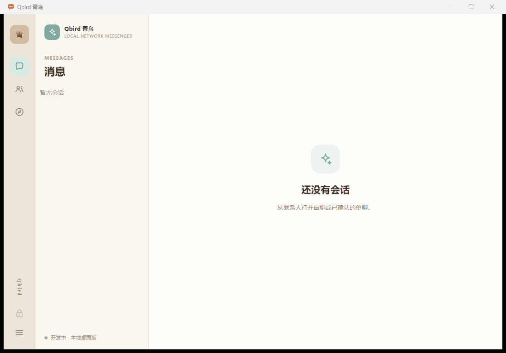

# Qbird · 轻书灵雀

**一款面向局域网的本地优先聊天工具。**

[English](README.md) · 简体中文

Qbird 的中文名暂定为 **轻书灵雀**。项目旨在让局域网用户直接通信，不依赖中转服务器。当前优先开发 Windows 版本；Linux 和 macOS 仍在规划中。

> **0.1.11 开发测试版**：当前不是正式产品。真实双机、多机及当前桌面界面验收尚未完成；本地数据库未加密，也尚未经过独立安全审计。**请勿用于真实通信或存储敏感信息。**

## 界面预览



*截图来自隔离、空数据的较早 0.1.9 开发版；0.1.11 已更新首次引导和发现界面。应用界面目前仍显示原中文名；「轻书灵雀」暂定，本次仅用于 README。*

## 功能介绍

以下能力已在开发版中不同程度地实现。自动化测试与真实环境验收不同，具体状态见[任务清单](docs/TASKS.md)。

| 功能 | 开发版现状 |
| --- | --- |
| **首次使用与发现** | 三步首次引导；同网段 mDNS 发现、手动地址、限速网段扫描和黑名单。添加联系人前探测对方指纹；可关闭自动接受联系人。 |
| **聊天会话** | 本地自聊、单聊和群聊，支持隐藏会话、未读计数、搜索、消息引用和群内 @ 成员；文字与最多 9 张图片可组成同一气泡。 |
| **联系人与群组** | 联系人资料、备注与分组；群邀请、成员管理与进群时间、按群名搜索与申请加入、群头像。群邀请默认需确认，可选自动加入。 |
| **文件与图片** | 单聊和群聊文件排队传输、断点续传与 SHA-256 校验；可配置接收目录及确认策略；支持图片查看和工作区预览，已完成的附件可用系统默认程序打开。 |
| **工作区与扩展** | 常用表情、本地表情收藏、输入设置、应用锁和存储配额。已提供实验性的本地**只读预览插件宿主**，但未内置文档查看器插件。 |
| **导出与备份** | 聊天记录纯文本导出、密码保护的导入导出；密码保护的数据库备份以及合并或覆盖恢复。数据库备份不包含身份私钥与附件。 |

Qbird 使用 **Tauri、Rust、TypeScript、Vite 和 SQLite** 构建。记录保存在本机；点对点通信不使用中转服务器。

## 快速开始

在 Windows x64 上运行开发版前，请准备：

- WebView2 Runtime 和 Microsoft C++ Build Tools；
- Rust MSVC 工具链，并确保 `cargo` 在 `PATH` 中；
- Node.js 和 pnpm（包管理器版本以 `package.json` 为准）。

在项目目录运行：

```bash
pnpm install --frozen-lockfile
pnpm tauri dev
```

检查命令：

```bash
pnpm build
cargo check --manifest-path src-tauri/Cargo.toml
```

Windows 下可使用 `pnpm tauri build` 构建 NSIS 安装包及可执行文件；生成的安装包和构建产物不存放在本仓库。数据目录与分发方式详见[产品需求文档](docs/PRD.md)。

## 当前限制

- **验收：**真实双机、群聊并发、异常网络及当前桌面界面验收尚未完成；本机或自动化测试通过不代表达到生产可用标准。
- **离线补发：**没有中转服务器，待发送消息或文件需相关双方同时在线才能补发或续传。
- **本地数据：**SQLite 数据库尚未加密；应用锁只隐藏界面，不加密存储数据，Windows 身份验证重置尚未实现。
- **备份范围：**数据库备份不包含身份私钥和附件；备份密码与应用锁密码独立。
- **扩展与平台：**插件宿主为实验性只读预览，不提供编辑、插件市场或内置文档查看器；Linux 和 macOS 尚未支持。

## 安全与隐私

Windows 上的本机身份私钥由 DPAPI 保护，单聊使用双向认证 TLS；发现信息和网络地址本身不代表可信身份。当前开发版默认自动接受联系人通知，可在设置中关闭。依赖联系人身份前，应通过独立可靠的渠道核对完整指纹。传输加密不等于本地数据加密。请勿提交身份密钥、聊天数据库、备份或机器私有配置。

## 项目进度

已实现功能、测试状态与待验收事项见[任务清单](docs/TASKS.md)，预期范围见[产品需求文档](docs/PRD.md)，实验性预览接口见[插件文档](docs/PLUGIN.md)。规划中的功能不代表已经交付。

## 许可证

本项目采用 [Apache License 2.0](LICENSE)。第三方依赖遵循各自许可证；公开发布前仍需完成依赖、素材和版权审查。
